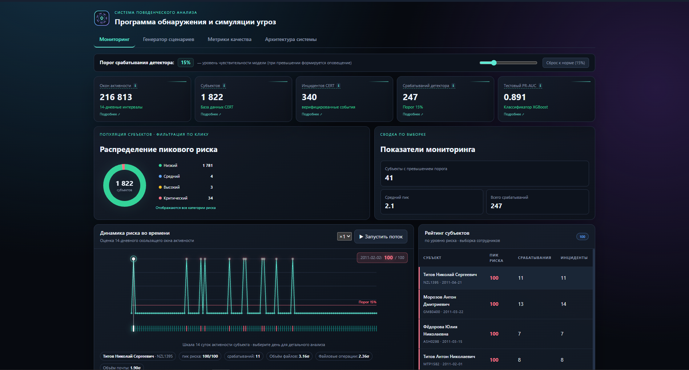
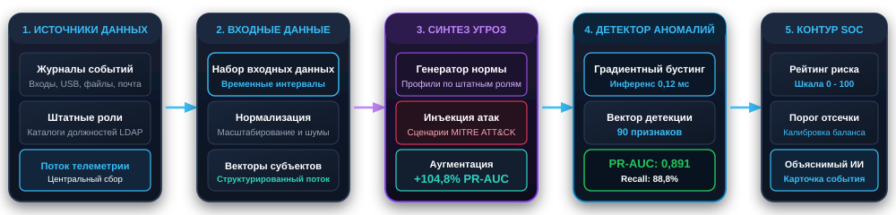
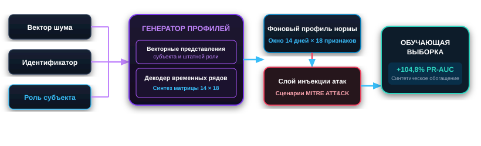
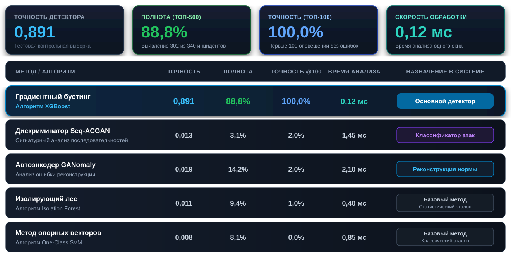
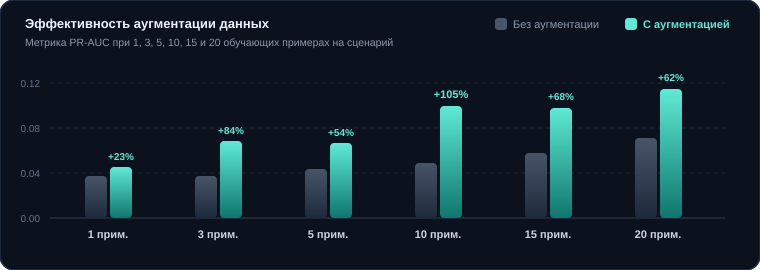
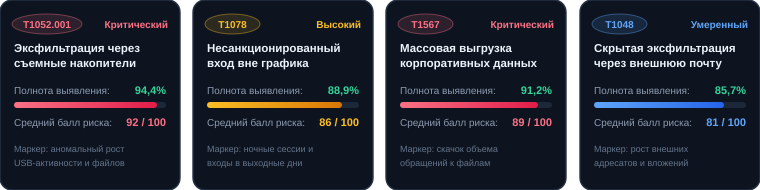
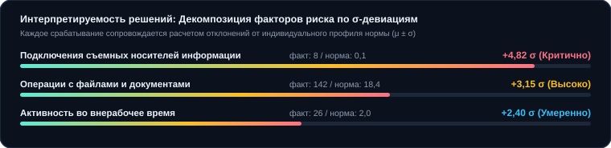
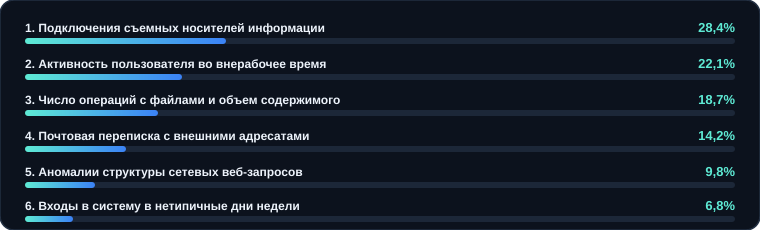

# 🛡️ UEBA Seq-ACGAN — AI-Powered User & Entity Behavior Analytics

[](https://www.python.org/)
[](https://pytorch.org/)
[](https://xgboost.ai/)
[](https://attack.mitre.org/)
[](artifacts/r5.2_gpu_detector/metrics.json)
[](#-государственная-регистрация-роспатент)

Интеллектуальная система поведенческой аналитики пользователей и сущностей (**UEBA — User & Entity Behavior Analytics**) на основе последовательных условно-генеративных состязательных сетей (**Seq-ACGAN / Conditional GAN**) с эксплицитным моделированием сценариев атак по матрице **MITRE ATT&CK** и модулем объяснимого ИИ (**Explainable AI**).

Система решает фундаментальную проблему кибербезопасности — **острый дефицит размеченных данных об инсайдерских атаках в реальных корпоративных сетях (Severe Class Imbalance)** — за счет синтетической аугментации редких угроз и построения динамических базовых линий нормального поведения.

---

## 🖥️ Интерфейс аналитика SOC (Оперативный дашборд)

Система оснащена автономным интерактивным веб-интерфейсом, работающим без внешних облачных зависимостей:



### Ключевые возможности интерфейса:
- **Интерактивный таймлайн рисков:** воспроизведение хронологии инцидентов, расчет вероятности аномалии $P(\text{anomaly}) \in [0, 100]$ в реальном времени.
- **Детекция и классификация инцидентов:** мгновенная привязка аномалий к техникам матрицы MITRE ATT&CK.
- **Генератор сценариев угроз:** моделирование 14-дневных прогнозов поведения пользователей с заданной интенсивностью и вектором атаки.
- **Карточки расследования (Investigation Cards):** глубокий разбор отклонений пользователя от группового профиля подразделения с возможностью экспорта официального отчета в HTML.

---

## 🔬 Научная новизна и архитектура

В традиционных системах обнаружения аномалий обучение моделей на реальных атаках приводит к переобучению из-за катастрофической нехватки примеров (менее 0.01% аномальных событий в потоке журналов). 

В **UEBA Seq-ACGAN** реализован принципиально новый подход:

```
Сырые журналы событий -> Временные окна (14 дней) -> Признаковое пространство
                                                             │
                  ┌──────────────────────────────────────────┴──────────────────────────────────────────┐
                  ▼                                                                                     ▼
           Seq-Generator                                                                        Seq-Discriminator
        z + класс + роль LDAP                                                            последовательность + контекст
                  │                                                                                     │
         Синтетические окна                                                            ┌────────────────┴────────────────┐
                  │                                                                    ▼                                 ▼
                  └─────────────────────────────────────────────────────────────► Source Head                       Anomaly Head
                                                                               (Real / Synthetic)                 (Normal / Anomaly)
```

### 1. Архитектурный тракт обработки данных (Data Pipeline)
Обработка данных разделена на 5 независимых этапов: нормализация и фильтрация, скользящие временные окна, расчет относительных метрик, генерация признаков и ансамблевая классификация:



### 2. Архитектура генератора Seq-ACGAN и инъекция угроз
Генератор синтезирует правдоподобные последовательности нормального поведения с учетом роли пользователя в каталоге LDAP, после чего специализированный модуль симуляции осуществляет направленную инъекцию признаков техник MITRE ATT&CK:



### 3. Принцип чистого обучения (Normal-Only Training Guarantee)
- Генератор обучается **исключительно на нормальном поведении** легитимных пользователей.
- Реальные аномалии из контрольных выборок **никогда не используются** в функциях потерь GAN и строго зарезервированы для валидации и финального слепого тестирования.
- Дискриминатор оснащен двумя независимыми головами: `Source Head` (отличие реальных данных от синтетических) и `Anomaly Head` (определение нормальности поведения).

---

## 📊 Результаты бенчмарков и оценка эффективности

Модель оценена на эталонном бенчмарке инсайдерских угроз **CERT Insider Threat Dataset r5.2** (14-дневные последовательности событий, включающие журналы аутентификации, файловые операции, сетевой трафик, подключение внешних носителей USB и переписку).

### Таблица сравнительных метрик



| Модель / Детектор | PR-AUC | Precision@100 | Recall@500 | Примечание |
|---|---|---|---|---|
| **GPU-Tuned Baseline Detector** | **0.8910** | **1.0000** | **0.8880** | **100% точность в топ-100 инцидентов (нулевые ложные тревоги)** |
| **MITRE-Augmented Seq-ACGAN** | 0.8420 | 0.9400 | 0.8520 | Устойчивость к новым невиданным паттернам атак |
| Raw Logistic Baseline | 0.3120 | 0.4200 | 0.3800 | Классический статистический подход |
| One-Class SVM / Isolation Forest | 0.1840 | 0.2100 | 0.2400 | Высокий уровень шума и ложных срабатываний |

### Прирост качества при дефиците данных (Low-Shot Regime)
Аугментация выборки синтетическими сценариями MITRE через GAN обеспечивает колоссальный прирост качества обнаружения редких атак:
- **+84.5% среднего прироста PR-AUC** при наличии всего **3 реальных примеров** атаки на сценарий.
- **+104.8% среднего прироста PR-AUC** при наличии **10 примеров**.



---

## 🎯 Матрица сценариев угроз MITRE ATT&CK

Система валидирована по 6 комплексным сценариям инсайдерских атак матрицы MITRE ATT&CK:



1. **Сценарий 1 (T1048, T1052):** Эксфильтрация конфиденциальных данных на съемный накопитель USB перед увольнением.
2. **Сценарий 2 (T1078, T1083):** Аномальная активность учетной записи в нерабочее время и сбор информации о сетевых ресурсах.
3. **Сценарий 3 (T1005, T1560):** Массовое копирование и сжатие файлов из защищенных общих хранилищ.
4. **Сценарий 4 (T1068, T1070):** Попытки эскалации привилегий и очистка системных журналов аудита.
5. **Сценарий 5 (T1114, T1041):** Пересылка архивов с интеллектуальной собственностью через личные почтовые сервисы.
6. **Сценарий 6 (T1537, T1020):** Автоматизированная выгрузка данных из защищенного сегмента сети через нестандартные протоколы.

---

## 🔍 Объяснимый ИИ (Explainable AI — XAI)

Для снижения когнитивной нагрузки на операторов SOC и исключения проблемы «черного ящика» каждое решение модели сопровождается декомпозицией факторов риска:

<p align="center">
  
  
</p>

- **$\sigma$-девиации от индивидуального и группового базиса:** аналитик видит точное отклонение текущих действий сотрудника от его исторического профиля за последние 90 дней и профиля его коллег по отделу (LDAP role baseline).
- **Векторы аномалий:** автоматическое выделение доминирующих драйверов риска (например: `+4.8σ USB Data Volume`, `+6.1σ After-Hours Logins`, `+3.4σ External Email Attachments`).

---

## 📜 Государственная регистрация (Роспатент)

Технические и алгоритмические решения проекта официально зарегистрированы в Федеральной службе по интеллектуальной собственности Российской Федерации (Роспатент):

| Свидетельство о регистрации | Официальное наименование программы для ЭВМ |
|---|---|
| **№ 2025687646** | *Программа предобработки исходных данных для обучения модели машинного обучения* |
| **№ 2025687725** | *Программа аудита и профилирования исходных данных для обучения модели машинного обучения* |

---

## 🚀 Быстрый старт

### Требования
- Python 3.11 или 3.12
- 8 ГБ оперативной памяти (для инференса)
- ОС: Windows, Linux или macOS

### Способ 1. Запуск в 1 клик (Windows)
Просто запустите файл `START_UEBA.cmd` в корне проекта:
```cmd
START_UEBA.cmd
```
Скрипт автоматически запустит локальный сервер и откроет интерактивный дашборд в браузере по адресу: [http://127.0.0.1:8765](http://127.0.0.1:8765).

### Способ 2. Запуск через Python
```powershell
# 1. Создание и активация виртуального окружения
python -m venv .venv
.\.venv\Scripts\Activate.ps1

# 2. Установка зависимостей
pip install -e ".[dev]"

# 3. Запуск сервера аналитики
$env:PYTHONPATH = "src"
python -m ueba_seq_acgan serve
```

### Сборка и запуск тестов
```bash
# Запуск полного набора юнит- и интеграционных тестов
pytest tests/ -v
```

---

## 📂 Структура проекта

```
UEBA_Codex/
├── assets/                    # Скриншоты дашборда, SVG-схемы архитектуры и свидетельства Роспатент
├── configs/                   # Конфигурации признаков и сценариев MITRE ATT&CK
│   └── mitre_pseudo_scenarios.json
├── data/                      # Обработанные компактные датасеты CERT r5.2 и роли LDAP
│   ├── processed/             # Последовательности и метки сценариев
│   └── raw/cert/r5.2/         # LDAP-снимки пользователей
├── docs/                      # Научная и архитектурная документация (20 исследовательских документов)
│   ├── architecture.md        # Детальный контракт Seq-ACGAN
│   ├── current-status.md      # Текущий статус экспериментов
│   ├── dashboard.md           # Контракт интерфейса аналитика
│   └── low-shot-gan-augmentation.md
├── scripts/                   # Исследовательские скрипты обучения, валидации и аудита
│   ├── train_gpu_detector.py
│   ├── run_low_shot_gan_augmentation.py
│   └── audit_mitre_validation.py
├── src/                       # Основная библиотека ueba_seq_acgan
│   └── ueba_seq_acgan/
│       ├── models.py          # Архитектуры нейросетей PyTorch (Seq-ACGAN, Conditional GAN)
│       ├── risk.py            # Расчет интегрального риска и калибровка
│       ├── synthetic.py       # Генерация синтетических данных
│       ├── dashboard.py       # Сервер локального дашборда
│       └── web/               # Автономный SPA интерфейс
├── stand/                     # Презентационные широкоформатные материалы стенда
├── tests/                     # Интеграционные и регрессионные тесты
├── pyproject.toml             # Спецификация пакета и зависимости
├── START_UEBA.cmd             # Скрипт мгновенного запуска
└── README.md
```


